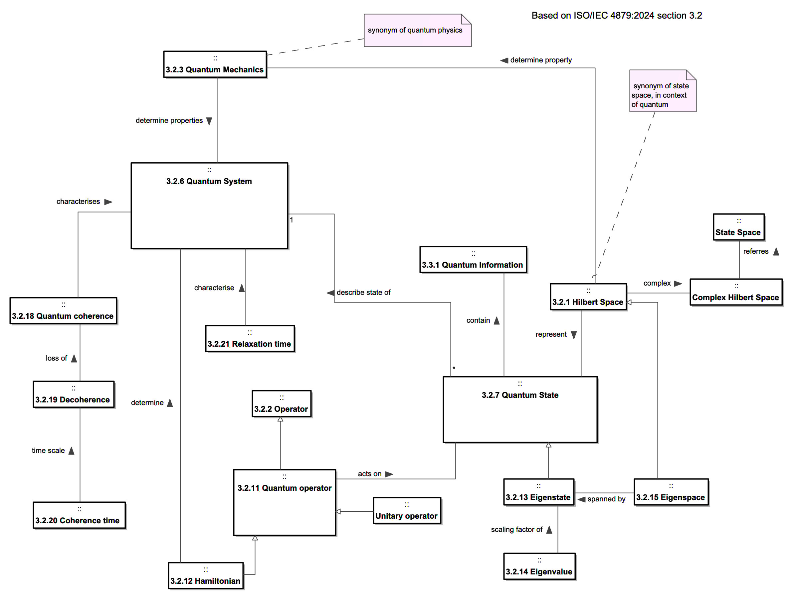
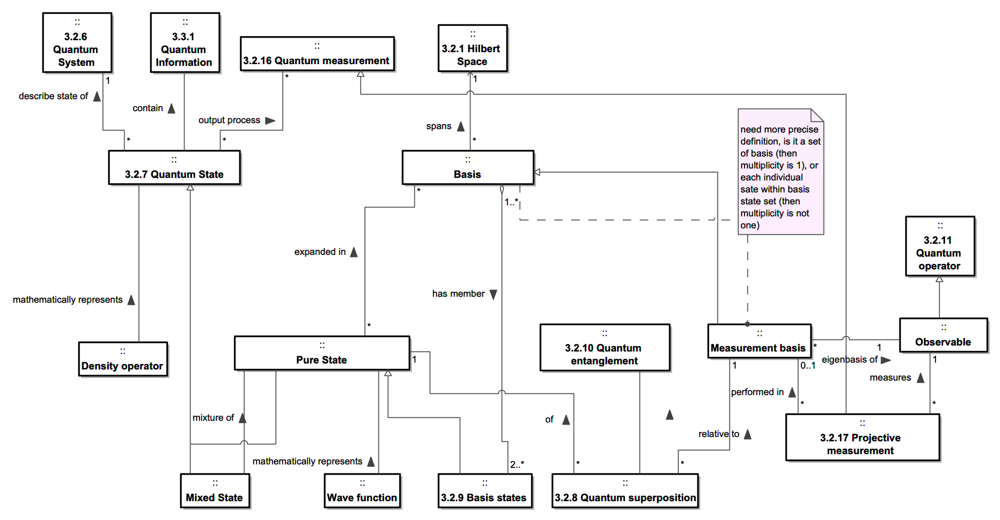
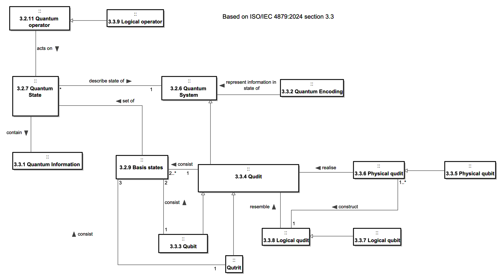

# QSysML-v2 ver.0.0.0 (Still under the initial development)

QSysML v2 is a SysML v2 library tailored for modelling of quantum systems (it is still under development).
The aim of this project is to develop a foundation for modelling of quantum systems which is currently considered challenging.
Official publication on this will be published soon.

The repository consists mainly of **.sysml** files and no tool-specific files. The quantum concept model is additionally provided as a MagicDraw/Cameo project file (.mdzip).
To try any of the SysML v2 models on this repository, you need to first download the sysml file then load it with a SysML v2 tool of your choice.

## Concept paper

The initial concept paper, **A Framework for Managing the Models of Engineered Quantum Systems** ([arXiv:2607.10347](https://arxiv.org/abs/2607.10347)).

As quantum technologies mature into systems that classical engineering must build, verify and maintain, their quantum domain models must be synchronised with the heterogeneous models created and owned by other communities. Existing synchronisation approaches are insufficient for engineered quantum systems. A model transformation could remove superposition and entanglement undetected while every structural check passes. The paper presents the Quantum Systems Model Management (QSysMM) Framework, which guides the construction and synchronisation of the models of a quantum system into a digital single source of truth. The framework addresses four concerns, ontological, abstraction, composition and exposure, and within it proposes QSysML, a Quantum Systems Modelling Language on the SysML v2 technology stack.

## Repository structure

- [`QSysML_Library/`](QSysML_Library) — core files of the QSysML v2 library
- [`Use_Case_QC/`](Use_Case_QC) — use case of QSysML on quantum computing (superconducting transmon qubit, gate operations, calculation library)
- [`Use_Case_QComm/`](Use_Case_QComm) — use case of QSysML on quantum communication (QKD protocols: BB84, E91)
- [`docs/images/`](docs/images) — diagrams used in the READMEs

## Quantum Concept Model

[`Quantum_Concept_Model.mdzip`](Quantum_Concept_Model.mdzip) defines the quantum domain concepts underlying QSysML v2. Some terminology is based on ISO/IEC 4879:2024 (*Information technology-Quantum Computing-Vocabulary*). The concept model is organised into the following concept areas.

### Quantum Physics Background

Foundational concepts based on ISO/IEC 4879:2024 section 3.2: quantum system, quantum mechanics, Hilbert space, quantum operator, Hamiltonian, coherence and decoherence.

### Quantum State

Quantum state concepts: pure and mixed states, wave function, basis, quantum superposition, entanglement, observables and projective measurement.

### Quantum Information

Concepts based on ISO/IEC 4879:2024 section 3.3: quantum information, qubit, qutrit, qudit, physical and logical qubits, quantum encoding.

## Use Case: Quantum Computing

The quantum computing use case ([`Use_Case_QC/`](Use_Case_QC)) applies QSysML v2 to the modelling of a superconducting-circuit quantum computer. 
It covers the physical layer — the fixed-frequency transmon qubit with its Josephson-junction/shunt-capacitor circuit, direct capacitive two-qubit coupling, and the cryogenic classical control and readout interface, and the logical layer: the universal gate set {H, T, CNOT}, transmon gate operations.
Details are in the [Use_Case_QC README](Use_Case_QC/README.md).

## Use Case: Quantum Communication

The quantum communication use case ([`Use_Case_QComm/`](Use_Case_QComm)) applies QSysML v2 to the modelling of quantum key distribution (QKD). 
It covers the BB84 prepare-and-measure protocol (Bennett & Brassard, 1984) and the E91 entanglement-based protocol (Ekert, 1991), modelled from logical and physical perspectives, together with the QKD apparatus kit — transmitter, receiver and intercept (Eve) modules — and a BB84 physical experiment. 
Details are in the [Use_Case_QComm README](Use_Case_QComm/README.md).

## License

This repository is licensed under the [MIT License](LICENSE).
Copyright (c) 2026 Loughborough Quantum Systems Engineering