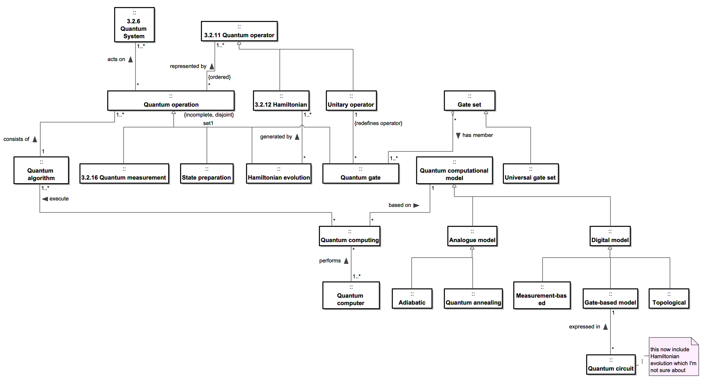

This is use case of QSysML on Quantum Computer

The diagram below shows the quantum computing concepts of the concept model: quantum operations, quantum algorithm, quantum gates and gate sets, computational models (analogue: adiabatic, quantum annealing; digital: gate-based, measurement-based, topological) and quantum circuits.
This use case is specifically focused on the superconductive qubit but concept model is general to quantum computing.

